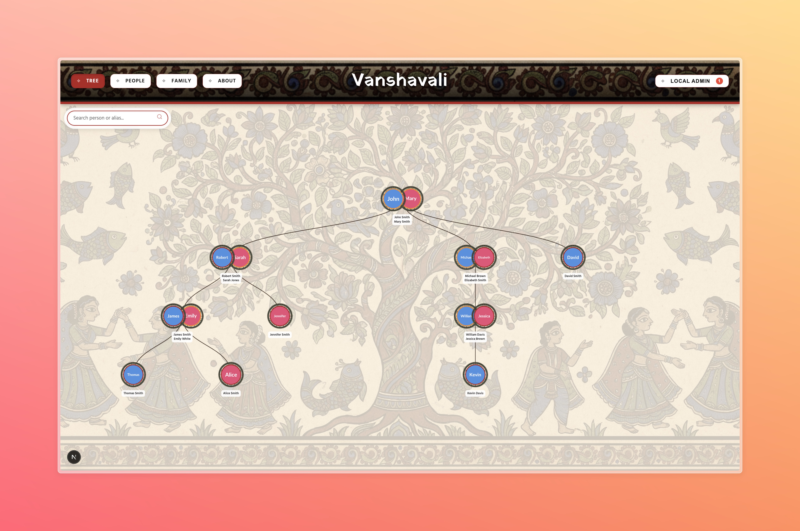

# Vanshavali



Vanshavali is a dynamic and interactive family tree application designed to bring your ancestry to life. It provides a collaborative platform for families to build, visualize, and manage their history in a secure and user-friendly environment.

## Features

- **Interactive Family Tree:** Visualize lineage with an elegant, zoomable, and draggable tree diagram powered by D3.js.
- **Rich Profile Management:** Create detailed profiles for family members, including aliases, photos, life events, and relationships.
- **Collaborative Editing:** Invite family members to contribute with role-based permissions (Admin, Editor, Viewer).
- **Suggestions System:** Users can submit feature requests or data corrections directly through the platform.
- **Admin Dashboard:** Dedicated interface for managing access requests, user roles, and reviewing site suggestions.
- **Local Development Mode:** Support for local development using mock data, allowing for offline work and testing.

## Tech Stack

- **Frontend:** [Next.js](https://nextjs.org/) (React)
- **Visualization:** [D3.js](https://d3js.org/)
- **Backend & Auth:** [Firebase](https://firebase.google.com/) (Realtime Database, Authentication, Storage)
- **Styling:** Modern Vanilla CSS with a custom rounded design system.
- **Deployment:** [Firebase App Hosting](https://firebase.google.com/docs/app-hosting)

## Getting Started

### Prerequisites

- Node.js (v18 or later)
- npm

### Installation

1. **Clone the repository:**

   ```bash
   git clone https://github.com/amulyaparitosh/Vanshavali.git
   cd Vanshavali
   ```

2. **Install dependencies:**

   ```bash
   npm install
   ```

3. **Environment Setup:**
   Copy `.env.sample` to `.env`. A single switch, `NEXT_PUBLIC_ENV`, picks the backend:
   ```env
   NEXT_PUBLIC_ENV=local   # local Supabase stack (Docker); "prod" for your cloud project
   ```
   For `local`, the URL and keys are built in — nothing else to set. For `prod`, fill the `NEXT_PUBLIC_SUPABASE_*`, `SUPABASE_SERVICE_ROLE_KEY`, and `DATABASE_URL` values.

### Running Locally

```bash
npm run stack:start   # boot the local Supabase stack (Docker; first run pulls images)
npm run db:setup      # schema + RLS + realtime + storage (targets NEXT_PUBLIC_ENV)
npm run dev           # → http://localhost:3000
```

## Local Development

`NEXT_PUBLIC_ENV=local` runs the app against a full **local Supabase stack** (real Postgres + Auth + Storage + Realtime in Docker via the Supabase CLI) — the exact same provider code as production. No cloud account needed, works offline, and RLS/auth/storage behave identically to prod.

- Sign up with any email/password — email confirmation is off locally, so you get a session immediately.
- Browse local data at Supabase Studio (`http://127.0.0.1:54323`).
- Outbound email (invites, resets) is caught by Mailpit at `http://127.0.0.1:54324`.

See **`docs/SUPABASE-SETUP.md`** for the complete local + cloud setup guide and troubleshooting.

## Deployment

This project is deployed using **Firebase App Hosting**.

The deployment is automated via a GitHub integration:

1. Any commits pushed to the `main` branch trigger an automatic build.
2. Firebase App Hosting handles the build process and deploys the new version once complete.

## Contributing

Contributions are welcome! Please open an issue or submit a pull request for any improvements or bug fixes.

## License

This project is licensed under the MIT License.
